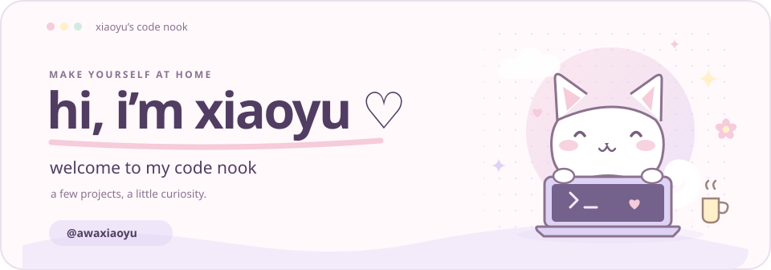
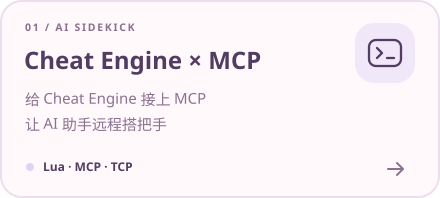
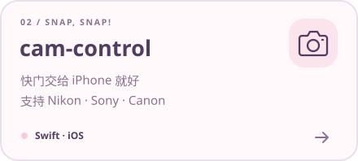
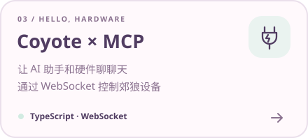
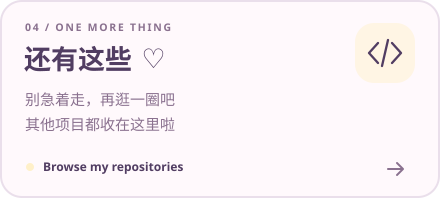

  <picture>
    <source media="(prefers-color-scheme: dark)" srcset="./assets/hero-dark.svg">
    
  </picture>

  <strong>欢迎光临喵~ ♡</strong> 
  项目都放在这里啦，随便逛逛～

  
  &nbsp;
  
  &nbsp;
  

 

### 🐾 我的拿手好戏

- 🎮 **游戏逆向 & 底层开发**：C / C++、Windows、内存分析、Hook 与 DMA 调试。
- 🤖 **AI Agent & MCP**：工具集成、任务编排与上下文管理。
- 🪄 **自动化 & 数据处理**：Playwright、接口对接、数据采集与批处理，把重复工作交给代码。
- 🧩 **全栈 & 桌面应用**：Go、Python、TypeScript，从 Web 服务到桌面 GUI。
- 🔐 **授权 & 安全设计**：身份认证、设备绑定、密钥管理与客户端保护。

### 🧶 用到的技术

  
  
  
  
  
  
  

 

### 🎀 公开项目精选

<a href="https://github.com/awaxiaoyu/CheatEngine-mcp-remote">
  <picture>
    <source media="(prefers-color-scheme: dark)" srcset="./assets/cheatengine-dark.svg">
    
  </picture>
</a>
<a href="https://github.com/awaxiaoyu/cam-control">
  <picture>
    <source media="(prefers-color-scheme: dark)" srcset="./assets/camera-dark.svg">
    
  </picture>
</a>

<a href="https://github.com/awaxiaoyu/dg-lab-coyote-mcp">
  <picture>
    <source media="(prefers-color-scheme: dark)" srcset="./assets/coyote-dark.svg">
    
  </picture>
</a>
<a href="https://github.com/awaxiaoyu?tab=repositories">
  <picture>
    <source media="(prefers-color-scheme: dark)" srcset="./assets/explore-dark.svg">
    
  </picture>
</a>

  点开卡片看看吧，没准有你感兴趣的 ♡

 

  <picture>
    <source media="(prefers-color-scheme: dark)" srcset="./assets/footer-dark.svg">
    
  </picture>

